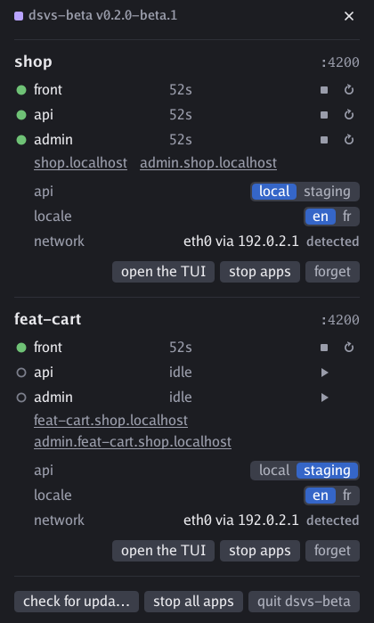
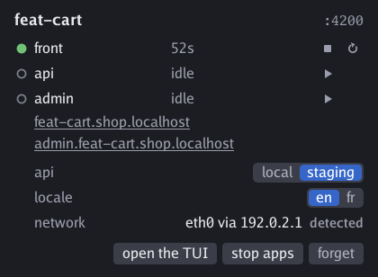

# La beta de dsvs

[English](BETA.md) · [README](README.fr.md)

La beta donne un avant-goût de la prochaine version de dsvs. Son binaire, `dsvs-beta`, s'installe **à côté** de `dsvs` et reste chez lui : ses propres sockets, son unité, son service, son répartiteur et ses projets retenus, et sa propre icône, aux barres violettes là où celles du stable sont blanches. Il lit son propre fichier de configuration : un projet ne passe à la beta que si vous le décidez, et le stable reste votre filet.

Cette page dit ce que la beta ajoute au [README](README.fr.md), qui décrit le stable : tout ce qu'il dit reste vrai, sauf là où cette page dit autre chose.



## L'installer à côté du stable

- Depuis le panneau de `dsvs` : **install the beta** apparaît dès qu'une beta est publiée et qu'aucune n'est installée. Une seconde icône apparaît.
- Depuis un terminal, même sans stable :

  ```sh
  curl -fsSL https://github.com/glimps-re/dsvs/releases/latest/download/install.sh | DSVS_CHANNEL=beta sh
  ```

`dsvs-beta` suit les pré-versions (`vX.Y.Z-beta.N`), et une version stable qui dépasse la dernière beta.

## Son propre fichier de configuration

`dsvs-beta` lit `config.beta.dsvs.ts`, ou `dsvs.beta.json`, cherché en remontant depuis le dossier courant, et **ne se rabat jamais** sur `config.dsvs.ts` : un projet tourne sur la beta une fois qu'on a copié sa configuration, ou qu'on nomme un fichier avec `--config`. Donnez un autre port à la copie, et les deux binaires servent le projet en même temps.

## Ce que la beta ajoute

- **[Un formulaire de paramètres](#les-paramètres--un-formulaire).** La configuration déclare des champs — le serveur derrière `/api`, une langue… — et se construit à partir de leurs valeurs. On les règle dans le panneau, dans l'interface en terminal ou avec `dsvs set api=staging`, et le formulaire peut retenir une valeur pour le projet, ou pour le réseau où se trouve la machine.
- **[Une icône qui dit ce qui tourne](#licône-et-le-panneau)**, ce qui démarre et ce qui est tombé, sans rien ouvrir, et un panneau redessiné.
- **Un onglet attend son app.** Une page ouverte pendant que son app démarre se recharge seule dès que l'app répond, ou dit pourquoi elle est tombée.
- **[Chaque app déclare ce que recharge une nouvelle configuration](#prête-et-rechargement)** avec la clé `reload`, et ce qui la dit prête avec `ready`. Le stable tapait `r` dans chaque app prête ; la beta ne tape rien qu'une app n'ait demandé.
- **[La configuration est vérifiée](#la-configuration-est-vérifiée)** : une clé inconnue, avec celle que vous vouliez sans doute dire, ou une valeur du mauvais type est refusée par son chemin. Un fichier que le stable acceptait avec une clé en trop est refusé.
- **[Les types TypeScript en paquet](#les-types-typescript)**, épinglés sur le binaire par `dsvs types`.
- **Sauvegarder en fait plus.** Le port suit le fichier, une redirection garde la suite du chemin, et le journal d'une app retirée de la configuration se lit jusqu'à la fin de la session.
- **De nouvelles commandes** : `set`, `remember`, `forget`, `types`, `panel --png`, `config nom=valeur`, et `dsvs run`, qui tient désormais une session ordinaire, que voient le panneau et les autres commandes, liée à son terminal.

## Utilisation

La liste des commandes et des options est l'aide de cette version, reproduite dans la [section Usage de BETA.md](BETA.md#usage).

## L'icône et le panneau


L'icône se lit sans rien ouvrir : des barres allumées et une pastille verte pleine quand quelque chose tourne et que tout va bien, un anneau ambre qui tourne pendant qu'une app démarre, une pastille rouge à croix quand une app est tombée. Quand rien ne tourne, les barres s'éteignent et la pastille s'en va. Son infobulle donne le binaire et sa version.

Un clic ouvre le panneau. Chaque app a un pictogramme pour démarrer ou arrêter et un pour relancer, et les paramètres d'une session se règlent sur place, comme un formulaire. En bas, **uninstall the beta** se tient à côté de la mise à jour. `dsvs-beta panel --png <fichier>` dessine le panneau dans un PNG, sans affichage.

## La configuration dans la beta

### La configuration est vérifiée

Node retire les types sans les vérifier : `satisfies Config` ne protège que dans l'éditeur. dsvs vérifie donc la forme de ce que le fichier construit, et le refuse comme une faute de syntaxe — la configuration d'avant continue de tourner — pour une clé qu'il ne lit pas, en proposant celle que vous vouliez sans doute dire, comme pour une valeur du mauvais type, chacune par son chemin : `apps[1]: unknown key "evn" (did you mean "env"?)`, `port: a number, not "4380"`. Un dsvs plus ancien le dit de même d'une clé qu'il ne connaît pas encore.

### Les types TypeScript

Le paquet `types/` déclare chaque champ et le documente : c'est la référence, et il remplace la copie de `config.ts`. Une configuration importe ses types de `"dsvs"` :

```ts
import type { Config } from "dsvs";

export default {
  port: 4200,
  ingress: [/* ... */],
  apps: [/* ... */],
} satisfies Config;
```

Le paquet ne contient que des déclarations : le code de `form()` et de ses règles vient du binaire, qui le sert sous le nom `"dsvs"` à la configuration et à ce qu'elle importe. Le paquet n'est donc pas nécessaire pour que la configuration tourne, et un projet l'installe en dépendance optionnelle, épinglée sur le tag du binaire :

```sh
pnpm add --save-optional "dsvs@$(dsvs-beta types)"
```

Le spécificateur est une URL `git+ssh` sur ce dépôt : il faut donc une clé SSH que GitHub connaît. Sans elle, pnpm installe tout le reste et sort en succès ; seul l'éditeur montre que les types manquent, par un import non résolu. Ce que pnpm en dit dépend de sa version et du lockfile : une ligne d'information, un avertissement qui porte l'erreur de git, ou rien du tout. pnpm 11 n'écrit même pas dans `package.json` une dépendance qu'il n'a pas pu résoudre : `pnpm add` ne change alors rien, et c'est depuis une machine qui a la clé qu'on ajoute les types. La CI du projet installe avec `pnpm install --frozen-lockfile --no-optional` et sort `*.dsvs.ts` de son tsconfig de build, pour ne pas typer un import absent.

### Ce qui change dans la référence

| Clé | Type | Dans la beta |
|---|---|---|
| `Route.redirect` | string | Une 302 vers ce chemin, suivi de ce qui suit `path` dans la requête et de sa query : avec `{ path: "/", redirect: "/shop" }`, `/products/12?color=red` mène à `/shop/products/12?color=red`. Une autre route doit prendre la cible. |
| `App.command` | string[] | Une app qu'une façade sert doit recevoir `{port}` ; une app qu'aucune route ne mène — un `tsc --watch`, un worker — s'en passe. |
| `App.env` | `Record<string, string \| undefined>` | Une valeur `undefined` n'en pose aucune. |
| `App.color` | string | Défaut : tirée de son nom. |
| `App.ready` | `{ http } \| { log }` | Nouvelle. Ce qui dit que l'app est prête, quand le signal par défaut ne dit rien. |
| `App.reload` | `"page" \| { stdin }` | Nouvelle. Ce que fait une configuration appliquée pour cette app. |

### Prête, et rechargement

Une app est **prête** quand une vraie requête par sa route obtient une réponse ; quand son port s'ouvre si aucune route ne la sert ; dès qu'elle est lancée si elle ne reçoit pas de port. Quand ce signal ne vaut rien pour elle, `ready` le remplace : `{ "http": "/health" }` la dit prête au premier 2xx sur ce chemin, `{ "log": "Watching for file changes" }` quand une ligne de sa sortie contient ce texte — en TypeScript, une RegExp aussi (`log: /compiled successfully/i`), lue par le RE2 de Go. Un navigateur qui ouvre le chemin d'une app en train de démarrer reçoit une page qui se recharge seule quand l'app répond, ou qui dit pourquoi elle est tombée.

Une configuration appliquée — une sauvegarde, `dsvs set`, un changement de réseau — ne **recharge** rien, sauf ce qu'une app déclare avec `reload` : `"page"` recharge les pages HTML qu'elle sert, par le proxy, et `{ "stdin": "r\n" }` tape exactement ce texte dans son terminal, ici le « force reload browser » de `ng serve`.

### Sauvegarder suffit, et plus

Le port est relu lui aussi : la session passe sur le nouveau et quitte l'ancien, ou, s'il est pris, refuse la configuration et dit qui le tient. Une app retirée de la configuration garde son journal jusqu'à la fin de la session : `dsvs logs worker` le montre, terminé par son départ, et remettre l'app reprend ce journal.

### Les paramètres : un formulaire

Une configuration peut déclarer des **paramètres** : un formulaire, que la construction consomme. `form(modèle, schéma)` déclare les champs par leur défaut — un booléen fait un flag, un nombre un nombre, un texte un texte, une liste un choix dont le défaut est en tête, un objet un groupe — et le schéma pose leurs règles ; `config(formulaire, construction)` construit la configuration à partir des valeurs résolues, une fois le formulaire valide. Les règles sont celles des Signal Forms d'Angular — `hidden`, `disabled`, `readonly`, `required`, `min`, `max`, `minLength`, `maxLength`, `pattern`, `validate`, `validateTree`, `apply`, `applyWhen` — plus quatre : `choices` et `defaultValue` donnent les choix et le défaut du moment (un choix peut être désactivé avec sa raison, et reste à vue), `keep` retient une valeur choisie pour le projet, et `network` la retient pour le réseau par où la machine sort. Le schéma reçoit aussi le **réseau observé** : les interfaces levées et les routes de sortie.



L'exemple d'une boutique, dont l'API vient du serveur local ou d'un serveur déployé (le code garde ses commentaires en anglais) :

```ts
import { choices, config, defaultValue, disabled, form, hidden, keep, max, min, network, validateTree } from "dsvs";
import servers from "./servers.dsvs.ts";

// The front of a shop: its API comes from the local server (the api app) or from a deployed one,
// staging — reachable from the company network — or demo, public.
const params = form(
  { api: ["local", "staging", "demo"], deployed: { version: ["v2", "v3"], traces: false }, slowApi: false, products: 20, locale: ["en", "fr"] },
  (p, observed) => {
    keep(p.locale);

    // The server to reach depends on the network: chosen once per network, it comes back with it.
    network(p.api);

    // staging is only reachable from the company network, through its tunnel, and so are its traces.
    const atWork = observed?.links.some((link) => link.name.startsWith("tun")) ?? false;
    choices(p.api, ["local", { value: "staging", disabled: !atWork && "staging is only reachable from the company network" }, "demo"]);
    defaultValue(p.api, atWork ? "staging" : "demo");
    hidden(p.deployed, { when: ({ valueOf }) => valueOf(p.api) === "local" });
    disabled(p.deployed.traces, { when: !atWork && "traces are only reachable from the company network" });

    // What the local server serves is only set when it is the one reached.
    hidden(p.slowApi, { when: ({ valueOf }) => valueOf(p.api) !== "local" });
    hidden(p.products, { when: ({ valueOf }) => valueOf(p.api) !== "local" });
    min(p.products, 0);
    max(p.products, 5000);

    validateTree(p, ({ valueOf }) =>
      valueOf(p.locale) === "fr" && valueOf(p.api) === "demo" ? { field: p.locale, message: "demo has no fr build" } : null,
    );
  },
);

export default config(params, ({ api, deployed, slowApi, products, locale }) => ({
  port: 4380,
  ingress: [
    {
      host: "shop.localhost",
      routes: [
        { path: "/", app: locale === "fr" ? "front-fr" : "front" },
        { path: "/admin", app: "admin" },
        { path: "/api", ...(api === "local" ? { app: "api" } : { proxy: { target: `${servers[api]}/${deployed.version}`, changeOrigin: true } }) },
      ],
    },
  ],
  apps: [
    // A hidden field is undefined here: products and slowApi only serve the local server, traces only a deployed one.
    { name: "api", command: ["node", "api.mjs", "--port={port}", ...(api === "local" ? [`--products=${products}`, ...(slowApi ? ["--slow"] : [])] : [])] },
    { name: "front", command: ["pnpm", "start", "--port={port}"], env: { API_TRACES: String(api !== "local" && deployed.traces) }, reload: { stdin: "r\n" } },
    /* front-fr, admin… */
  ],
}));
```

**D'où vient une valeur.** Une valeur est la première intention qui existe : celle qu'on vient de demander, celle retenue pour le réseau si le champ le suit, celle de la session — choisie, ou ramenée par le dernier réseau qui en avait une —, et celle retenue pour le projet s'il la garde. Elle vaut si elle est parmi les choix du moment et qu'aucune règle ne la désactive ; sinon le défaut répond — ou le premier choix actif —, et l'intention revient dès qu'elle redevient possible. Sur un réseau qui n'a rien retenu, la valeur en vigueur reste, et ce qu'on y choisit s'y retient. Une valeur retenue, c'est tout ce qui n'est pas le geste en cours ; celle que les règles de son champ ne prennent plus, comme un `max` abaissé sous elle, **cède** : au bord qu'elle dépasse pour `min` et `max`, au défaut sinon. La configuration s'applique, l'intention reste en mémoire, et dsvs le dit tant que ça dure — au journal, sous le champ dans le panneau et la TUI, dans `dsvs state` et dans la sortie de la commande qui a rejoué : `products=20 no longer holds (at most 15): products=15 until it does`. Une valeur retenue fait lister le projet, comme `dsvs remember`, et `dsvs forget` l'oublie avec lui.

**Un geste est une soumission.** `dsvs set` refuse, avec sa raison, un champ caché, désactivé ou en lecture seule, une valeur illisible, hors des choix ou désactivée, et une valeur qui rendrait le formulaire invalide, et rien ne change. Deux champs liés se demandent ensemble : `dsvs set api=staging deployed.version=v3`. Le panneau et la TUI se remplissent comme un formulaire, dans l'ordre qu'on veut : un choix qui exige un autre champ reste choisi, le champ qui manque dit ce qu'il attend, et rien ne s'applique avant le geste qui le complète, qui applique tout ensemble ; ce n'est qu'alors que les choix se retiennent. Un formulaire que le contexte rend invalide quand même — un défaut qui ne tient pas, une erreur du formulaire entier — garde la configuration en vigueur, et `dsvs state` le dit ; au démarrage, `dsvs run nom=valeur` choisit ce qui le rend valide.

**Les champs cachés.** Un champ caché n'a pas de valeur pour la construction : il y vaut `undefined`, tous les champs d'un groupe caché aussi, et la construction ne doit pas s'en servir — `api === "local" ? products : 0`. Les règles, elles, voient toujours la valeur qu'il garde, et qu'il retrouve en réapparaissant. Les types restent ceux du modèle, puisque le schéma est fixe : `api === "stagin"`, `p.deployed.verison` ou un choix hors de la liste sont des erreurs de type, un champ caché lu sans garde n'en est pas une. dsvs le rattrape : quand un champ est caché, il construit une seconde fois avec sa valeur gardée, et si le résultat diffère, la configuration s'en sert quand même et dsvs le dit comme une valeur qui cède — `slowApi, products are hidden, yet apps.api.command[3] depends on them` —, la configuration retenue restant celle construite sans.

Sans formulaire, l'export par défaut reste un objet, ou une fonction qui ignore ses arguments. `export const params` est l'ancienne forme, et elle est refusée.

`dsvs config` construit une configuration à formulaire à partir de ce qu'aurait une session ouverte ici, plus les valeurs demandées par-dessus, et l'écrit sans son formulaire : `dsvs config api=staging` donne l'instantané de la boutique sur staging. `dsvs config --session` écrit celle qui est en vigueur dans la session qui tourne, et `--params --session` dit d'où vient chaque valeur.

### N'importe quel programme est une configuration

Node n'est qu'une implémentation d'un contrat que tout exécutable peut remplir, passé par `--config` : `.json` est une configuration nue, `.ts`, `.mts`, `.js` et `.mjs` passent par node, tout autre fichier est exécuté lui-même. Il reçoit dans `DSVS_INPUT` une ligne de JSON — les intentions couche par couche, en texte, flags compris, et `observed`, `null` quand rien n'observe le réseau :

```json
{"asked":{"deployed.version":"v3"},"network":{"api":"staging"},"session":{"slowApi":"true"},"kept":{"locale":"en"},"observed":{"links":[{"name":"tun0","type":"tuntap","addrs":["10.8.0.2/24"]}],"exits":[{"via":"198.51.100.1","dev":"eth0"}]}}
```

`DSVS_CONFIG` porte son chemin, et son dossier courant est celui du fichier. Il écrit sur stdout `{"form":{"fields":[…],"errors":[…],"notices":[…]},"config":{…}}` : chaque champ résolu, dans l'ordre — `name`, `type` (`choice`, `flag`, `text` ou `number`), `choices`, `disabledChoices` avec chaque raison, `value`, `from` (`asked`, `network`, `session`, `kept` ou `default`), ses états `hidden`, `disabled` et ses `reasons`, `readonly`, `keep`, `network`, `errors`, et `yielded`, la valeur retenue qui ne tient plus, avec sa couche et ses erreurs —, puis `notices`, ce que le formulaire dit sans rien refuser, et la configuration que ces valeurs construisent, `null` quand le formulaire a une erreur. Ce qu'il écrit sur stderr va au journal de la session. Un code de sortie non nul, un JSON illisible ou dix secondes sans réponse sont une erreur qui ne change rien. Un `dsvs.json` est une configuration nue, sans formulaire.

## Les mises à jour du canal beta

`dsvs-beta update`, ou le panneau de la beta, prend la dernière pré-version, ou une version stable qui la dépasse, de la même façon que le stable se met à jour : vérifiée, et sans arrêter vos apps. Outre une session qui tourne hors de la boîte systemd, une session que tient `dsvs run` garde son binaire jusqu'à ce qu'elle s'arrête : elle appartient à son terminal, et la mise à jour le dit.

## Retirer la beta

**uninstall the beta**, dans le panneau de `dsvs-beta`, ferme ses sessions, retire son unité et son binaire, et laisse `dsvs` tel qu'il était.
