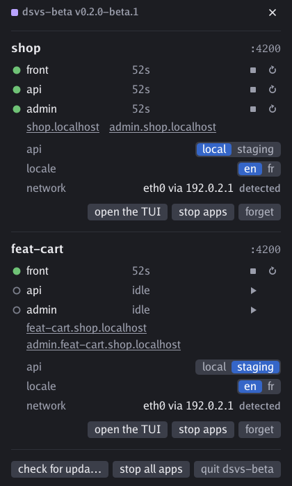
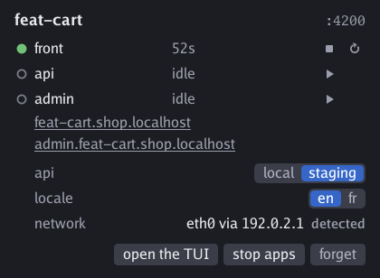

# dsvs beta

[Français](BETA.fr.md) · [README](README.md)

The beta previews the next version of dsvs. Its binary, `dsvs-beta`, installs **beside** `dsvs` and keeps to itself: its own sockets, unit, service, hub and remembered projects, and its own icon, with violet bars where the stable's are white. It reads its own configuration file, so a project moves to the beta only when you decide so, and the stable stays your fallback.

This page says what the beta adds to [the README](README.md), which describes the stable: everything there still holds, except where this page says otherwise.



## Install it beside the stable

- From the panel of `dsvs`: **install the beta** shows up once a beta is published and none is installed. A second icon appears.
- From a terminal, even without a stable:

  ```sh
  curl -fsSL https://github.com/glimps-re/dsvs/releases/latest/download/install.sh | DSVS_CHANNEL=beta sh
  ```

`dsvs-beta` follows the pre-releases (`vX.Y.Z-beta.N`), and a stable release that overtakes the last beta.

## Its own configuration file

`dsvs-beta` reads `config.beta.dsvs.ts`, or `dsvs.beta.json`, searched up from the current directory, and **never falls back** to `config.dsvs.ts`: a project runs on the beta once you copy its configuration, or name a file with `--config`. Give the copy another port and both binaries serve the project at once.

## What the beta adds

- **[A form of parameters](#parameters-a-form).** The configuration declares fields — the server behind `/api`, a locale… — and builds itself from their values. You set them in the panel, in the terminal interface or with `dsvs set api=staging`, and the form can keep a value for the project, or for the network the machine is on.
- **[An icon that tells what runs](#the-icon-and-the-panel)**, what starts and what fell, without opening anything, and a redesigned panel.
- **A tab waits for its app.** A page opened while its app starts reloads by itself once the app answers, or says why it fell.
- **[Each app declares what a new configuration reloads](#ready-and-reload)** with the `reload` key, and what says it is ready with `ready`. The stable typed `r` in every ready app; the beta types nothing an app did not ask for.
- **[The configuration is checked](#the-configuration-is-checked):** an unknown key, with the one you probably meant, or a value of the wrong type is refused by its path. A file the stable accepted with an extra key is refused.
- **[The TypeScript types as a package](#the-typescript-types)**, pinned to the binary by `dsvs types`.
- **Saving does more.** The port follows the file, a redirect keeps the rest of the path, and the log of an app removed from the configuration stays readable until the session ends.
- **New commands:** `set`, `remember`, `forget`, `types`, `panel --png`, `config name=value`, and `dsvs run`, which now holds an ordinary session that the panel and the other commands see, tied to its terminal.

## Usage

The block below is the help of this version, generated from the command table by `go generate ./cmd/dsvs`: do not edit it by hand.

<!-- dsvs help -->
```
dsvs — control panel for dev-servers

  dsvs [options] <command> [options] [arguments]

Commands:
  start [--all] <name...>        start the apps these names pull in
  stop [--all] <name...>         stop the apps these names pull in
  restart [--all] <name...>      restart the apps these names pull in
  reload                         make the session read its configuration again
  set <name=value...>            give parameters of the configuration a value, and replay it
  quit                           stop the apps of the session and close it
  state [--json]                 write what the session here is doing
  logs [-n <lines>] [name...]    write the end of the logs, or follow them with -f
  run [name...] [name=value...]  hold the session in this terminal, streaming the logs
  status [--json]                write what runs on this machine, and who holds the ports
  service [stop|restart]         start the background service and its icon, or stop it
  update                         take a newer version, the beta for dsvs-beta, and restart the service
  panel [--png <file>]           open the panel of the running sessions
  remember                       remember the project here, so that the panel lists it cold
  forget                         forget the project here, which the panel stops listing
  config [name=value...]         write the resolved configuration as JSON
  types                          write the package specifier of the TypeScript types matching this binary
  skill                          write a skill that teaches this tool to a coding agent
  help [command]                 write what a command does, or the list of them

A name is an app, a facade — which pulls in the apps of its routes — or a group declared in the
configuration. The session port is taken when it starts, follows the configuration, and is released
when it stops; every facade answers on it, and a path leading to a stopped app answers 502. A
browser opening the path of an app that is starting gets a page that reloads by itself when the app
answers, or says why it fell. An applied configuration reloads nothing but what an app declares with
its reload key: "page" reloads the pages it serves, { stdin: "…" } types exactly that text in its
terminal.

dsvs needs a configuration: the one named by --config, or the first one found searching up from the
current directory. Everything it needs around it starts on demand and says so — the background
service and its icon, then the session, which lives without a terminal and survives the commands and
interfaces that watch it.

dsvs with no command starts what the configuration found here needs, writes the state of its session
and returns; --tui opens the interface on that session instead. A configuration runs only once, and
two sessions never fight over a host: the second one is refused, and says so.

A few flags are the binary talking to itself — --tray, --hub, --session, --install-unit,
--remove-unit, --version — and are not commands.

Options, before or after the command:
  --config <file>
    	path of the configuration file (default: the first config.dsvs.ts found searching up)
  --net <network>
    	apps network: "auto", "netns" to require it, "loopback" to do without (default: auto)
  --port <port>
    	session port, instead of the one in the configuration
  --port-shift <offset>
    	offset added to the port the configuration declares, so that a second binary can serve the same projects
  --tui
    	open the interface on the session, instead of returning
  --watch <path>
    	path whose save makes the configuration reload, on top of those it declares; repeatable
```
<!-- /dsvs help -->

## The icon and the panel


The icon reads without opening anything: lit bars and a solid green dot when something runs and all is well, a spinning amber ring while an app starts, a red dot with a cross when an app fell. When nothing runs, the bars dim and the dot goes away. Its tooltip gives the binary and its version.

A click opens the panel. Each app has a start/stop and a restart pictogram, and the parameters of a session are set right there, like a form. At the bottom, **uninstall the beta** sits beside the update. `dsvs-beta panel --png <file>` draws the panel into a PNG, without a display.

## The configuration in the beta

### The configuration is checked

Node strips the types without checking them: `satisfies Config` only protects you in the editor. dsvs therefore checks the shape of what the file builds, and refuses it like a syntax error — the previous configuration keeps running — for a key it does not read, suggesting the one you probably meant, as for a value of the wrong type, each by its path: `apps[1]: unknown key "evn" (did you mean "env"?)`, `port: a number, not "4380"`. An older dsvs says the same of a key it does not know yet.

### The TypeScript types

The `types/` package declares every field and documents it: it is the reference, and it replaces the copy of `config.ts`. A configuration imports its types from `"dsvs"`:

```ts
import type { Config } from "dsvs";

export default {
  port: 4200,
  ingress: [/* ... */],
  apps: [/* ... */],
} satisfies Config;
```

The package holds declarations only: the code of `form()` and its rules comes from the binary, which serves it under the name `"dsvs"` to the configuration and to what it imports. The package is therefore not needed for the configuration to run, and a project installs it as an optional dependency, pinned to the tag of the binary:

```sh
pnpm add --save-optional "dsvs@$(dsvs-beta types)"
```

The specifier is a `git+ssh` URL on this repository, so it needs an SSH key that GitHub knows. Without one, pnpm installs everything else and exits with success; only the editor shows the missing types, by an unresolved import. What pnpm says depends on its version and on the lockfile: an info line, a warning that carries the git error, or nothing at all. pnpm 11 does not even write into `package.json` a dependency it could not resolve, so `pnpm add` then changes nothing: add the types from a machine that has the key. The project's CI installs with `pnpm install --frozen-lockfile --no-optional` and leaves `*.dsvs.ts` out of its build tsconfig, so as not to type an import that is absent.

### What changes in the reference

| Key | Type | In the beta |
|---|---|---|
| `Route.redirect` | string | A 302 to this path, followed by what comes after `path` in the request and its query: with `{ path: "/", redirect: "/shop" }`, `/products/12?color=red` leads to `/shop/products/12?color=red`. Another route must take the target. |
| `App.command` | string[] | An app a facade serves must take `{port}`; one that no route leads to — a `tsc --watch`, a worker — does not need it. |
| `App.env` | `Record<string, string \| undefined>` | An `undefined` value sets nothing. |
| `App.color` | string | Default: drawn from its name. |
| `App.ready` | `{ http } \| { log }` | New. What says the app is ready, when the default signal says nothing. |
| `App.reload` | `"page" \| { stdin }` | New. What an applied configuration does for this app. |

### Ready and reload

An app is **ready** when a real request through its route gets an answer; when its port opens if no route serves it; as soon as it is launched if it takes no port. When that signal means nothing for it, `ready` replaces it: `{ "http": "/health" }` is ready at the first 2xx on that path, `{ "log": "Watching for file changes" }` when a line of its output contains that text — in TypeScript, a RegExp too (`log: /compiled successfully/i`), read by Go's RE2. A browser opening the path of an app that is starting gets a page that reloads by itself once the app answers, or says why it fell.

An applied configuration — a save, `dsvs set`, a change of network — **reloads** nothing, except what an app declares with `reload`: `"page"` reloads the HTML pages it serves, through the proxy, and `{ "stdin": "r\n" }` types exactly that text in its terminal, here the "force reload browser" of `ng serve`.

### Saving is enough, and more

The port is read again too: the session moves to the new one and leaves the old one, or, if it is taken, refuses the configuration and says who holds it. An app removed from the configuration keeps its log until the session ends: `dsvs logs worker` shows it, ending with its departure, and putting the app back takes up that log.

### Parameters: a form

A configuration can declare **parameters**: a form that the build consumes. `form(model, schema)` declares the fields by their default — a boolean makes a flag, a number a number, a string a text, a list a choice with the default first, an object a group — and the schema sets their rules; `config(form, build)` builds the configuration from the resolved values, once the form is valid. The rules are those of Angular's Signal Forms — `hidden`, `disabled`, `readonly`, `required`, `min`, `max`, `minLength`, `maxLength`, `pattern`, `validate`, `validateTree`, `apply`, `applyWhen` — plus four: `choices` and `defaultValue` give the choices and default of the moment (a choice can be disabled with its reason, and stays in sight), `keep` keeps a chosen value for the project, and `network` keeps it for the network the machine goes out by. The schema also receives the **observed network**: the links that are up and the routes out.



```ts
import { choices, config, defaultValue, disabled, form, hidden, keep, max, min, network, validateTree } from "dsvs";
import servers from "./servers.dsvs.ts";

// The front of a shop: its API comes from the local server (the api app) or from a deployed one,
// staging — reachable from the company network — or demo, public.
const params = form(
  { api: ["local", "staging", "demo"], deployed: { version: ["v2", "v3"], traces: false }, slowApi: false, products: 20, locale: ["en", "fr"] },
  (p, observed) => {
    keep(p.locale);

    // The server to reach depends on the network: chosen once per network, it comes back with it.
    network(p.api);

    // staging is only reachable from the company network, through its tunnel, and so are its traces.
    const atWork = observed?.links.some((link) => link.name.startsWith("tun")) ?? false;
    choices(p.api, ["local", { value: "staging", disabled: !atWork && "staging is only reachable from the company network" }, "demo"]);
    defaultValue(p.api, atWork ? "staging" : "demo");
    hidden(p.deployed, { when: ({ valueOf }) => valueOf(p.api) === "local" });
    disabled(p.deployed.traces, { when: !atWork && "traces are only reachable from the company network" });

    // What the local server serves is only set when it is the one reached.
    hidden(p.slowApi, { when: ({ valueOf }) => valueOf(p.api) !== "local" });
    hidden(p.products, { when: ({ valueOf }) => valueOf(p.api) !== "local" });
    min(p.products, 0);
    max(p.products, 5000);

    validateTree(p, ({ valueOf }) =>
      valueOf(p.locale) === "fr" && valueOf(p.api) === "demo" ? { field: p.locale, message: "demo has no fr build" } : null,
    );
  },
);

export default config(params, ({ api, deployed, slowApi, products, locale }) => ({
  port: 4380,
  ingress: [
    {
      host: "shop.localhost",
      routes: [
        { path: "/", app: locale === "fr" ? "front-fr" : "front" },
        { path: "/admin", app: "admin" },
        { path: "/api", ...(api === "local" ? { app: "api" } : { proxy: { target: `${servers[api]}/${deployed.version}`, changeOrigin: true } }) },
      ],
    },
  ],
  apps: [
    // A hidden field is undefined here: products and slowApi only serve the local server, traces only a deployed one.
    { name: "api", command: ["node", "api.mjs", "--port={port}", ...(api === "local" ? [`--products=${products}`, ...(slowApi ? ["--slow"] : [])] : [])] },
    { name: "front", command: ["pnpm", "start", "--port={port}"], env: { API_TRACES: String(api !== "local" && deployed.traces) }, reload: { stdin: "r\n" } },
    /* front-fr, admin… */
  ],
}));
```

**Where a value comes from.** A value is the first intention that exists: the one just asked for, the one kept for the network if the field follows it, the session's — chosen, or brought back by the last network that had one — and the one kept for the project if it keeps it. It holds if it is among the choices of the moment and no rule disables it; otherwise the default answers — or the first enabled choice — and the intention comes back once it is possible again. On a network that kept nothing, the value in force stays, and what you choose there is kept for it. A kept value is anything but the gesture in progress; one that the rules of its field no longer take, such as a `max` lowered under it, **yields**: to the bound it crosses for `min` and `max`, to the default otherwise. The configuration applies, the intention stays in memory, and dsvs says so while it lasts — in the log, under the field in the panel and the TUI, in `dsvs state` and in the output of the command that replayed it: `products=20 no longer holds (at most 15): products=15 until it does`. A kept value makes the project listed, as `dsvs remember` does, and `dsvs forget` forgets it with the project.

**A gesture is a submission.** `dsvs set` refuses, with its reason, a hidden, disabled or read-only field, an unreadable value, one outside the choices or disabled, and one that would make the form invalid, and nothing changes. Two linked fields are asked together: `dsvs set api=staging deployed.version=v3`. The panel and the TUI fill in like a form, in any order: a choice that requires another field stays chosen, the missing field says what it waits for, and nothing applies before the gesture that completes it, which applies everything at once; only then are the choices kept. A form that the context makes invalid anyway — a default that does not hold, an error on the whole form — keeps the configuration in force, and `dsvs state` says so; at start, `dsvs run name=value` picks what makes it valid.

**Hidden fields.** A hidden field has no value for the build: it is `undefined` there, every field of a hidden group too, and the build must not use it — `api === "local" ? products : 0`. The rules always see the value it keeps, which it finds again when it reappears. The types stay those of the model, since the schema is fixed: `api === "stagin"`, `p.deployed.verison` or a choice outside the list are type errors, a hidden field read without a guard is not. dsvs catches that: when a field is hidden, it builds a second time with its kept value, and if the result differs, the configuration uses it anyway and dsvs says so like a value that yields — `slowApi, products are hidden, yet apps.api.command[3] depends on them` — while the kept configuration stays the one built without it.

Without a form, the default export stays an object, or a function that ignores its arguments. `export const params` is the former shape, and is refused.

`dsvs config` builds a configuration with a form from what a session opened here would have, plus the values asked on top, and writes it without its form: `dsvs config api=staging` is the snapshot of the shop on staging. `dsvs config --session` writes the one in force in the running session, and `--params --session` says where each value comes from.

### Any program is a configuration

Node is one implementation of a contract that any executable can fulfil, passed with `--config`: `.json` is a bare configuration, `.ts`, `.mts`, `.js` and `.mjs` go through node, any other file is run itself. It receives in `DSVS_INPUT` one line of JSON — the intentions layer by layer, as text, flags included, and `observed`, `null` when nothing observes the network:

```json
{"asked":{"deployed.version":"v3"},"network":{"api":"staging"},"session":{"slowApi":"true"},"kept":{"locale":"en"},"observed":{"links":[{"name":"tun0","type":"tuntap","addrs":["10.8.0.2/24"]}],"exits":[{"via":"198.51.100.1","dev":"eth0"}]}}
```

`DSVS_CONFIG` holds its path, and its working directory is the file's folder. It writes on stdout `{"form":{"fields":[…],"errors":[…],"notices":[…]},"config":{…}}`: each resolved field in order — `name`, `type` (`choice`, `flag`, `text` or `number`), `choices`, `disabledChoices` with each reason, `value`, `from` (`asked`, `network`, `session`, `kept` or `default`), its states `hidden`, `disabled` and its `reasons`, `readonly`, `keep`, `network`, `errors`, and `yielded`, the kept value that no longer holds with its layer and errors — then `notices`, what the form says without refusing anything, and the configuration those values build, `null` when the form has an error. What it writes on stderr goes to the session log. A non-zero exit, unreadable JSON or ten seconds without an answer are an error that changes nothing. A `dsvs.json` is a bare configuration, without a form.

## Updates on the beta channel

`dsvs-beta update`, or the panel of the beta, takes the latest pre-release, or a stable release that overtakes it, the same way the stable updates: checked, and without stopping your apps. Besides a session running outside the systemd box, a session held by `dsvs run` keeps its binary until it stops: it belongs to its terminal, and the update says so.

## Remove the beta

**uninstall the beta**, in the panel of `dsvs-beta`, closes its sessions, removes its unit and its binary, and leaves `dsvs` as it was.
