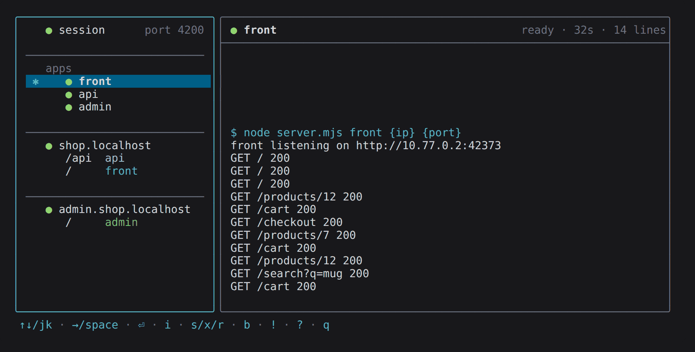
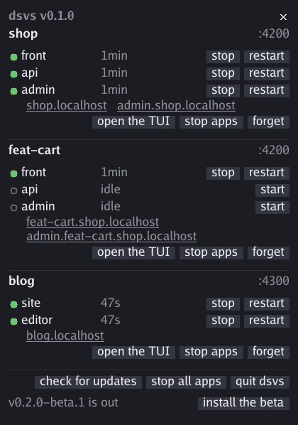
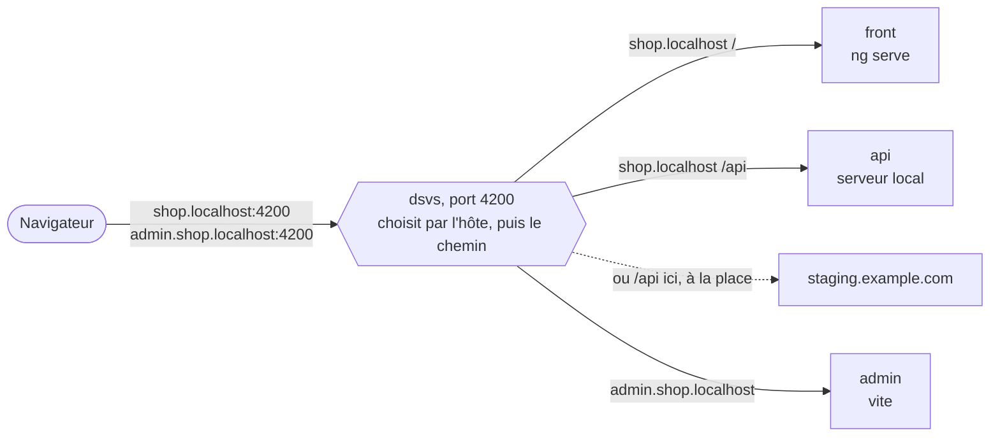
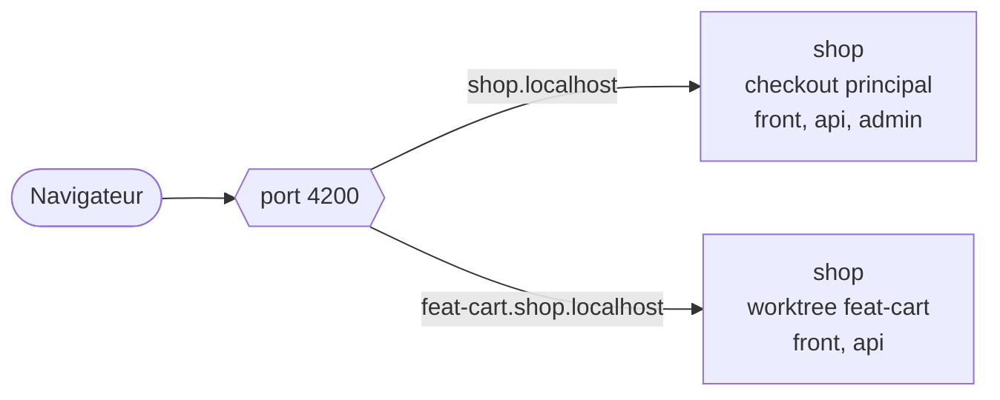
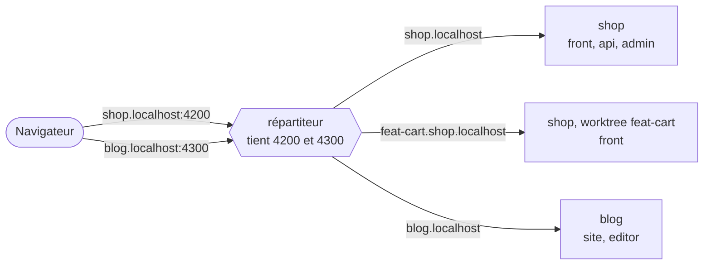
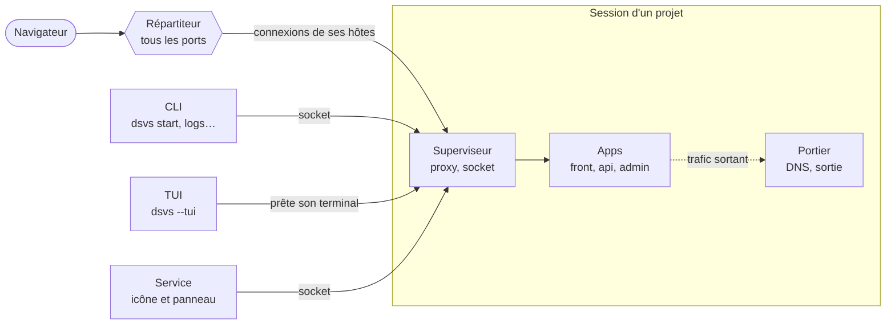

# dsvs — un panneau de contrôle pour les serveurs de développement

[English](README.md)

dsvs fait tourner les serveurs de développement d'un projet — un `ng serve`, un `vite`, une API sur votre machine ou distante — derrière une seule adresse, comme la production les sert, et vous les fait piloter depuis la ligne de commande, une interface en terminal ou un panneau derrière une icône de la barre d'état.

Les exemples qui suivent prennent un projet fictif : une boutique, avec un `front`, une `api` et un `admin`.

## Installer

```sh
curl -fsSL https://github.com/glimps-re/dsvs/releases/latest/download/install.sh | sh
```

Il faut Linux avec systemd, et node seulement si votre configuration est écrite en TypeScript. La commande pose `dsvs` dans `~/.local/bin` et démarre son service : l'icône apparaît dans la barre d'état. [L'installation en détail](#linstallation-en-détail) dit ce qu'elle vérifie en plus, et comment changer l'endroit où elle installe.

## Pourquoi dsvs

- **Une seule adresse et un seul port pour toutes les apps, comme en production.** `shop.localhost:4200` sert le front et envoie son `/api` à l'API, `admin.shop.localhost:4200` sert le back-office. Le front appelle son API sur sa propre origine, le rechargement à chaud passe, et les navigateurs résolvent `*.localhost` tout seuls : pas de `/etc/hosts`, pas de sudo.
- **On ne démarre que ce dont on a besoin.** Rien ne démarre tout seul : `dsvs start front` démarre le front, `dsvs start shop.localhost` toutes les apps où mènent ses routes.
- **On change de backend sans rien redémarrer.** Pointez `/api` sur votre `api` locale ou sur `staging.example.com` et sauvegardez : la route change, votre `ng serve` continue de tourner.
- **Plusieurs worktrees côte à côte, sur le même port.** Chacun sert son propre hôte : `feat-cart.shop.localhost:4200` à côté de `shop.localhost:4200`.
- **Plusieurs projets à la fois, chacun sur son port.** La boutique sur 4200, un blog sur 4300 : un seul processus tient tous les ports.
- **Aucun conflit de port, sans root.** dsvs donne à chaque app son port. Les apps écoutent sur un réseau privé, et seuls les ports que vous déclarez s'ouvrent sur la machine.
- **Un journal par app**, dans l'interface en terminal ou avec `dsvs logs api`.
- **Mettre dsvs à jour n'arrête pas vos apps.**

## Trois interfaces, et votre agent

Les mêmes sessions, pilotées d'où vous êtes. Fermez n'importe laquelle : les apps continuent de tourner.

**La ligne de commande**, pour vos mains et vos scripts :

```sh
dsvs start front api   # démarre ces apps, et ce dont elles ont besoin autour
dsvs logs api          # la fin du journal de l'api
dsvs status            # ce qui tourne sur la machine, et qui tient les ports
dsvs quit              # arrête les apps du projet d'ici, et ferme sa session
```

`dsvs help` liste toutes les commandes, comme le montre [Les commandes](#les-commandes), et `dsvs help <commande>` en détaille une.

**L'interface en terminal**, `dsvs --tui` : les apps et les façades du projet d'ici à gauche, le journal de celle qu'on a choisie à droite. `?` liste ses touches.



**Le panneau**, derrière l'icône  de la barre d'état : chaque projet ouvert, ses apps, ses adresses à ouvrir dans le navigateur, et les gestes pour les démarrer, les arrêter et les relancer.



### Votre agent de code

dsvs écrit un skill pour Claude Code, ou tout agent qui charge des skills : ce qu'est dsvs, ses commandes, et lesquelles interroger pour le reste. L'agent démarre alors des apps, lit leurs journaux et vérifie ce qui tourne tout seul, par `dsvs help`, `dsvs state` et `dsvs logs`, au lieu de deviner.

```sh
mkdir -p ~/.claude/skills/dsvs
dsvs skill > ~/.claude/skills/dsvs/SKILL.md
```

Le skill vient de la même table de commandes que l'aide : régénérez-le après une mise à jour.

## Comment ça marche

Toutes les adresses mènent au même port. dsvs lit l'hôte que le navigateur a demandé, puis le chemin, et passe la requête à l'app ou au serveur distant qui est derrière :



Deux checkouts du même projet se partagent ce port. Chacun tourne dans sa propre session, qui déclare ses hôtes :



D'autres projets tournent à côté, sur leur propre port. Un seul processus, le répartiteur, tient tous les ports, et passe chaque connexion à la session qui déclare son hôte :



## L'essayer

Dans le dossier de votre front, écrivez un `dsvs.json` : une adresse, le front derrière `/`, et `/api` envoyé sur staging.

```json
{
  "port": 4200,
  "ingress": [
    {
      "host": "shop.localhost",
      "routes": [
        { "path": "/", "app": "front" },
        { "path": "/api", "proxy": { "target": "https://staging.example.com", "changeOrigin": true } }
      ]
    }
  ],
  "apps": [
    { "name": "front", "command": ["npm", "run", "start", "--", "--port", "{port}"] }
  ]
}
```

Démarrez le front, puis ouvrez `http://shop.localhost:4200/` :

```sh
dsvs start front
```

dsvs démarre ce dont il a besoin autour, et le dit.

## Les concepts

- Une **app** est un processus que la configuration déclare.
- Une **façade** est un hôte et sa table de routage : elle sert des apps, des cibles de proxy et des redirections, et ne démarre rien elle-même.
- Un **groupe** est un ensemble nommé d'apps, qu'on démarre et qu'on lit d'un seul geste.
- Une **session** fait tourner les apps d'une configuration. Elle vit sans terminal et survit aux commandes et aux interfaces qui la regardent.
- Le **service** tourne en arrière-plan : il pose l'icône dans la barre d'état et ouvre le panneau.
- Le **répartiteur** tient les ports. Il n'appartient à aucun service : la première session qui a besoin d'un port le lance, et il s'en va avec la dernière.

Tout démarre au besoin, et le dit.

## Les commandes

La liste des commandes et des options est la sortie de `dsvs help`, reproduite dans la [section Commands du README anglais](README.md#commands). `dsvs help <commande>` détaille une commande et ses options ; `?` liste les touches de la TUI.

## L'installation en détail

### Prérequis

- **Linux, avec une session `systemd --user`.** Le réseau privé est fait de namespaces réseau, et c'est systemd qui lance le service et met chaque session dans une boîte. Sans lui, dsvs tourne en mode dégradé, et le dit.
- **Node 22.18 ou plus (23.6 ou plus dans la branche 23)** pour un `config.dsvs.ts` : dsvs importe le TypeScript tel quel, grâce au type stripping que node active par défaut depuis ces versions. Un `dsvs.json` ne demande pas node.
- **`curl`** pour installer, et **`~/.local/bin` dans le `PATH`**.
- **Une barre d'état X11 qui accueille les icônes XEmbed**, pour l'icône. Sans elle, tout se fait depuis le terminal et la TUI, et `dsvs panel` ouvre le panneau sur un affichage X.

### Le script d'installation

Le script télécharge le binaire de la dernière release pour cette machine (amd64 ou arm64), le vérifie contre le `checksums.txt` de la release avant qu'il ne prenne aucune place, et le pose dans `~/.local/bin`. Il écrit ensuite une unité `systemd --user` et démarre le service : l'icône est dans la barre d'état quand le prompt revient, et la dernière ligne dit ce qui s'est passé. L'unité relance le service à chaque ouverture de session. Comme c'est systemd qui le lance, et non un shell, le service prend l'environnement de votre shell de login : ce qu'il lance trouve `node`, `pnpm` et le reste comme un terminal le ferait.

- `DSVS_VERSION=v0.1.0` installe cette version au lieu de la dernière.
- `DSVS_DIR=/un/bin` installe dans un autre dossier.
- `DSVS_RELEASES` désigne un miroir organisé comme les releases GitHub.

`dsvs --version` dit ce qui est installé, `dsvs status` ce qui tourne. [CONTRIBUTING.md](CONTRIBUTING.md#releases) montre comment vérifier une release à la main, empreintes et provenance du build.

`dsvs update`, ou **check for updates** puis **update to vX.Y.Z** dans le panneau, prend une version plus récente sans arrêter vos apps : [comment se font les mises à jour](#comment-se-font-les-mises-à-jour).

### Construire depuis les sources

Avec Go et un clone, le chemin de qui travaille sur dsvs :

```sh
git clone https://github.com/glimps-re/dsvs.git
cd dsvs && ./build.sh --install     # → ~/.local/bin/dsvs, version = git describe
```

Le binaire prend le nom de la branche — `main` donne `dsvs`, `feat/x` donne `dsvs-x` — et tout ce qui l'isole en dérive : sockets, icône, répartiteur, unité systemd et projets retenus. Un binaire de branche tourne donc à côté de votre `dsvs` de tous les jours sans le toucher, et son icône a des barres ambre. Le port, lui, est global : le second binaire qui le demande est refusé, avec le nom, la version et la session de celui qui le tient. Pour servir les mêmes projets depuis un second binaire, on lui donne un décalage de port à l'installation — `DSVS_PORT_SHIFT=100 ./build.sh --install`, ou `dsvs-x --install-unit --port-shift 100` — que son unité garde d'une réinstallation et d'une mise à jour à l'autre : ses façades répondent alors au port déclaré plus 100.

Un binaire construit depuis un clone se met à jour depuis ce clone, voir [comment se font les mises à jour](#comment-se-font-les-mises-à-jour). [CONTRIBUTING.md](CONTRIBUTING.md) couvre les tests, les hooks git et les conventions de commit.

## L'icône et le panneau

L'icône ouvre le panneau ; son infobulle donne le binaire et sa version. Les projets ouverts y restent listés d'une ouverture de session à l'autre, à froid, chacun avec trois gestes : démarrer ou arrêter ses apps, ouvrir sa TUI ou la rappeler à l'écran, ou l'oublier. Chaque app se démarre, s'arrête et se relance, et chaque façade s'ouvre dans le navigateur. En bas, deux gestes distincts : arrêter les apps de tous les projets, ou quitter dsvs, icône comprise ; puis la mise à jour, et la ligne de [la beta](#la-beta).

## Configuration

Le dossier du projet porte un `config.dsvs.ts` — du code, que node évalue une fois — ou un `dsvs.json`, quand il n'a pas de raison d'exiger node. Les deux suivent le même contrat : l'extension décide de qui lit le fichier, et rien en aval ne sait duquel il vient. dsvs le cherche en remontant depuis le dossier courant ; `--config` en nomme un autre. [L'essayer](#lessayer) montre un `dsvs.json` minimal.

Le même en TypeScript, dans un `config.dsvs.ts` :

```ts
import type { Config } from "./config.ts";

export default {
  port: 4200,
  ingress: [/* ... */],
  apps: [/* ... */],
} satisfies Config;
```

[`config.ts`](config.ts) déclare chaque champ et le documente : c'est la référence. Il n'y a pas encore de paquet : un projet en garde une copie, prise au tag de son binaire. Il exporte aussi `group(nom, apps)`, qui construit un groupe à partir de déclarations d'apps.

Le fichier est du code : il peut lire un manifeste, interroger le workspace, ou importer un fichier de cibles resté hors de git. `DSVS_CONFIG` porte son chemin absolu pendant l'évaluation, de quoi se situer sans rien deviner. L'`export default` peut aussi être une fonction, `async` comprise. Node retire les types sans les vérifier : `satisfies Config` ne protège que dans l'éditeur.

C'est ainsi qu'un worktree sert ses propres hôtes à côté du checkout principal, sur le même port — ici, le dossier du checkout le nomme :

```ts
import { basename, dirname } from "node:path";

const checkout = basename(dirname(process.env.DSVS_CONFIG!));
const host = checkout === "shop" ? "shop.localhost" : `${checkout}.shop.localhost`;
```

`dsvs config` écrit la configuration telle que dsvs la voit — défauts appliqués, routes ordonnées — dans le format JSON qu'il sait relire.

### Référence

`Config`, l'export par défaut :

| Clé | Type | |
|---|---|---|
| `port` | number | Le seul port ouvert sur la machine ; chaque façade y répond. |
| `ingress` | `Ingress[]` | Les façades, une par hôte. Plusieurs peuvent mener à la même app. |
| `apps` | `App[]` | |
| `groups` | `{ name, members }[]` | Des ensembles qu'on démarre par leur nom et qu'on lit d'une ligne, leurs journaux fusionnés. `members` sont des noms d'apps, chacun une fois ; un groupe ne contient ni façade ni groupe. |
| `subnet` | string | La plage des adresses virtuelles des apps. Défaut `10.77.0.0/24` ; à changer si elle entre en collision avec un VPN. La première adresse revient au portier. |
| `watch` | string[] | Les chemins dont une sauvegarde fait relire la configuration, en plus de `--watch`. Un dossier surveille ses fichiers `*.dsvs.ts`, un fichier lui-même. Défaut : le dossier de la configuration. Un chemin qui n'existe pas est refusé. |

`Ingress`, une façade :

| Clé | Type | |
|---|---|---|
| `host` | string | L'hôte qui désigne la façade, `"shop.localhost"` par exemple. Omis, la façade répond pour tout ce qu'aucune autre ne réclame. |
| `name` | string | Son nom dans les interfaces et les journaux. Défaut : son hôte. Jamais le nom d'une app. |
| `routes` | `Route[]` | Ce que devient chaque chemin. Le plus spécifique gagne, quel que soit l'ordre, et `"/"` prend le reste ; sans lui, un chemin sans route est un 404. |

`Route` : un `path` — un préfixe sans barre finale, si bien qu'un `baseHref` s'écrit tel quel — et exactement une de ces clés :

| Clé | Type | |
|---|---|---|
| `app` | string | L'app qui reçoit ces chemins. |
| `proxy` | `{ target, secure?, changeOrigin? }` | Une cible distante, écrite comme une entrée du `proxy.conf.json` d'Angular, mêmes mots, mêmes défauts. `target` est une URL http ou https dont le chemin préfixe celui de la requête. `secure: false` accepte un certificat qu'on ne peut pas vérifier. `changeOrigin: true` envoie l'hôte de la cible au lieu de celui du navigateur, ce que veut tout vhost distant. |
| `redirect` | string | Une 302 vers ce chemin. Elle ne reporte pas la suite du chemin demandé. |

`App` :

| Clé | Type | |
|---|---|---|
| `name` | string | |
| `command` | string[] | Argv, exécuté sans shell, dans un terminal que dsvs lui prête. Une app ne choisit pas son adresse : dsvs lui en réserve une et remplace `{port}` et `{ip}`, ici comme dans `env`. `{port}` est obligatoire : sans lui, rien ne saurait où joindre l'app. |
| `env` | `Record<string, string>` | Les variables posées par-dessus l'environnement de la session. |
| `dir` | string | Le dossier de travail, absolu ou relatif à la configuration. Défaut : son dossier. |
| `color` | string | Sa couleur dans les journaux : `red`, `green`, `yellow`, `blue`, `magenta` ou `cyan`. Défaut : prise dans une palette, dans l'ordre. |

### Sauvegarder suffit

Les façades, les routes, les cibles de proxy et les groupes sont relus sans rien redémarrer. Ce qui est vivant — le port, le sous-réseau, les processus — reste tel quel, et le journal le dit. Une fois la configuration appliquée, dsvs tape `r` et entrée dans le terminal de chaque app prête — le « force reload browser » de `ng serve` — pour que les pages ouvertes reviennent avec les nouvelles cibles. dsvs surveille le fichier de configuration lui-même, quel que soit son nom, les chemins qu'il déclare (`watch`), ceux de la ligne de commande (`--watch`), et à défaut son dossier : un import qui vit ailleurs doit être déclaré, sinon le sauvegarder ne recharge rien.

Les apps suivent la déclaration, sans qu'aucun processus ne soit coupé sous les pieds de qui s'en sert. Une app déclarée en cours de session apparaît, prête à démarrer. Une app dont la commande a changé se marque `↻ restart pending` : elle tourne avec la précédente, et c'est son redémarrage qui prend la nouvelle. Une app retirée de la configuration se marque `⊘ gone from the configuration` : elle tourne tant qu'on la laisse tourner, repart avec ce qu'elle avait, et quitte la liste une fois arrêtée. La remettre en fait de nouveau une app ordinaire, à redémarrer.

## Sous le capot

### Les processus



C'est le même binaire, dans des rôles différents :

- **Le service** (`dsvs --tray`) tient l'icône et le panneau, et rien d'autre : ni les apps, ni les ports. L'unité systemd qu'écrit le script d'installation le lance à l'ouverture de session ; une commande qui en a besoin le lance aussi. Il s'en va avec `dsvs service stop`, ou **quit dsvs** dans le panneau.
- **La session** (`dsvs --session`), une par configuration, tient les apps, leurs journaux, le proxy qui sert les façades, et la socket à laquelle parlent les clients. La première commande lancée dans le projet la démarre, ou **start** dans le panneau ; elle tourne dans sa propre boîte systemd, sans terminal, et s'en va avec `dsvs quit`.
- **Le répartiteur** (`dsvs --hub`) tient tous les ports que déclarent les sessions, et passe chaque connexion, non lue, à la session qui déclare son hôte. La première session qui a besoin d'un port le lance, hors de toute session ; il s'en va avec la dernière.
- **Le portier** est la moitié d'une session qui reste dans le réseau de la machine pendant que ses apps vivent dans le réseau privé : il résout leur DNS et rejoue leurs connexions sortantes par la pile de la machine elle-même, VPN et proxy système compris. Il vient et s'en va avec sa session.
- **Les apps** sont lancées par leur session quand vous les nommez, chacune dans un terminal que la session lui prête, sur une adresse et un port que la session réserve. Elles s'arrêtent avec `dsvs stop`, ou avec leur session.
- **La CLI et la TUI** sont des clients. Une commande parle à la session par sa socket et rend la main ; la TUI est dessinée par la session elle-même, sur le terminal que le client lui prête. Les fermer n'arrête rien.

### Ce qui tourne pendant une session

Par défaut, les apps n'ouvrent **aucun port** sur la machine : elles vivent sur des adresses virtuelles dans un namespace réseau sans privilèges, dont le trafic et le DNS sortent par la pile de la machine elle-même, VPN et proxy système compris. `--net loopback` s'en passe, `--net netns` l'exige au lieu de retomber en silence. La session se réexécute dans une unité systemd éphémère, sa boîte : un arrêt brutal ne laisse alors aucun processus derrière, pas même ce qu'un runner détache. Sans session systemd, elle tourne sans boîte, le dit, et cette garantie-là n'est plus.

Une configuration ne tourne qu'une fois, et deux sessions ne se disputent jamais un hôte : la seconde est refusée, et le dit.

### Comment se font les mises à jour

Un binaire installé depuis une release télécharge le nouveau en HTTPS et le vérifie contre les empreintes de sa release avant de remplacer quoi que ce soit : `dsvs` suit les versions stables, `dsvs-beta` les pré-versions aussi. Le panneau cherche une version plus récente à chaque ouverture. L'ancien binaire reste à côté du nouveau, en `.old`, et reprend sa place si le nouveau ne démarre pas.

Une mise à jour n'arrête pas vos apps. Chaque session passe la main au nouveau binaire sans changer de PID : sa boîte systemd ne voit rien passer, et ses apps restent ses enfants. La mise à jour en rend compte session par session, en demandant à chacune la version qu'elle porte désormais. Le service et le portier du réseau privé passent la main de la même façon. Le répartiteur n'est pas dérangé : il prend le nouveau binaire en s'en allant avec sa dernière session, et une session qui le perd entre-temps en relance un sans rien lâcher.

Une session qui tourne hors de la boîte systemd garde son binaire jusqu'à ce qu'elle s'arrête : là, le signal de mort du parent est le seul filet contre les apps orphelines, et il ne survivrait pas à la passation. Une version qui change le protocole entre les sessions et leur répartiteur — c'est rare, et le journal le dit — refuse de se mélanger : tant qu'une session de l'ancienne tourne, une nouvelle session s'arrête sur un message qui nomme les deux versions. Fermer les sessions ouvertes suffit.

Un binaire [construit depuis un clone](#construire-depuis-les-sources) se met à jour depuis ce clone : `dsvs update` récupère les commits, reconstruit, remplace et relance, en disant chaque étape. Un clone qui porte des modifications non commitées refuse, parce que ce qu'il construirait n'aurait pas de version qui le distingue ; un clone laissé sur une autre branche aussi, parce que `dsvs-next` ne s'installe pas sous le nom `dsvs`. Mettre à jour depuis un clone construit et lance ce que porte l'amont : **qui peut pousser sur cette branche exécute du code sur votre machine**. C'est le dessein, et c'est ce que fait `git pull && ./build.sh --install` à la main.

### Comment c'est construit

Chaque paquet porte ses décisions, ce qui a été essayé puis écarté, et ses limites connues dans son commentaire de paquet : `go doc ./internal/hub`, `go doc ./internal/core`, `go doc ./cmd/dsvs`, et ainsi de suite. Les coutures entre eux :

- `config` charge et valide, et rien en aval ne revérifie ; `core` supervise ; `gateway` sert ; `hub` tient le port et le répartit ; `fdpass` fait voyager les descripteurs de fichier, par une socket comme à travers un exec, et porte le cadrage des lignes du protocole ; `ui/*` consomment des instantanés et un flux d'événements qui peut déborder sans perdre un réveil — les lignes de journal, elles, peuvent tomber, et le flux dit combien.
- `core.Network` dit où les apps écoutent, `core.Front` qui tient le port : deux questions, deux interfaces. `core.Gateway` et `core.Network` sont les points de remplacement — un nginx piloté, loopback ou netns — et une interface web ne serait qu'un consommateur de plus du core.

## La beta

La beta donne un avant-goût de la prochaine version. Elle s'installe **à côté** de `dsvs`, sous le nom `dsvs-beta`, avec son propre fichier de configuration, et le stable reste votre filet. [BETA.fr.md](BETA.fr.md) dit comment l'installer et comment la retirer.

## Contribuer

Les issues et les pull requests sont les bienvenues. [CONTRIBUTING.md](CONTRIBUTING.md) explique comment construire et tester, les conventions de commit et la façon dont se font les releases ; [SECURITY.md](SECURITY.md) comment signaler une vulnérabilité.

## Licence

dsvs est publié sous [licence MIT](LICENSE).
