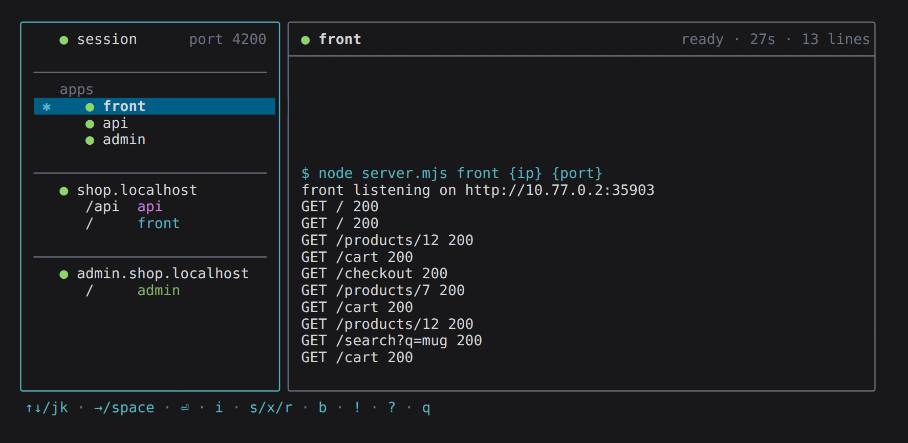
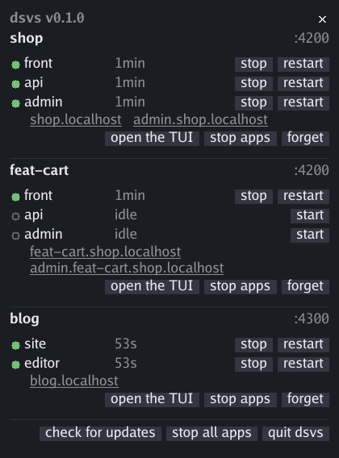
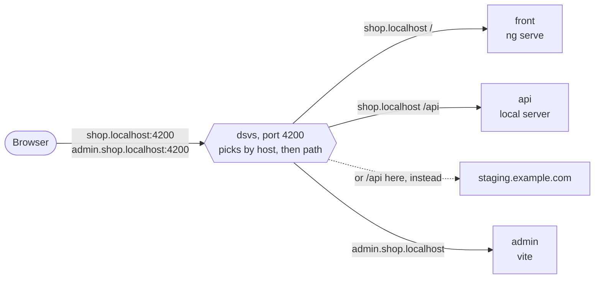
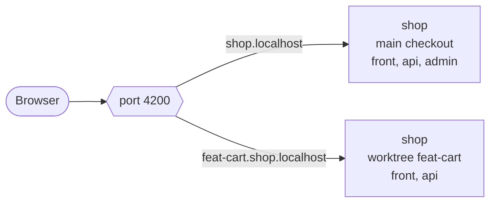
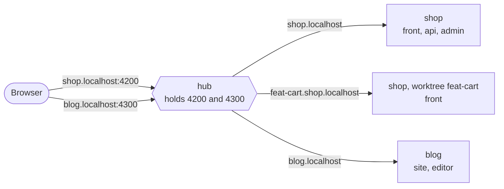
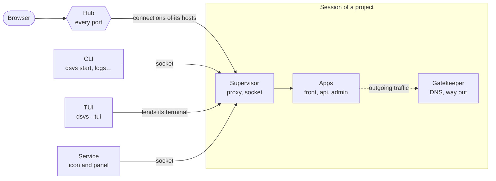

# dsvs — a control panel for dev servers

[Français](README.fr.md)

dsvs runs the dev servers of a project — an `ng serve`, a `vite`, an API on your machine or a remote one — behind a single address, the way production serves them, and lets you drive them from the command line, a terminal interface or a panel behind a status bar icon.

The examples below follow a made-up project: a shop, with a `front`, an `api` and an `admin`.

## Install

```sh
curl -fsSL https://github.com/glimps-re/dsvs/releases/latest/download/install.sh | sh
```

You need Linux with systemd, and node only if your configuration is written in TypeScript. The command puts `dsvs` in `~/.local/bin` and starts its service: the icon appears in the status bar. [Install in detail](#install-in-detail) says what else it checks, and how to change where it installs.

## Why dsvs

- **One address and one port for every app, as in production.** `shop.localhost:4200` serves the front and routes its `/api` to the API, `admin.shop.localhost:4200` serves the back office. The front calls its API on its own origin, hot reload goes through, and browsers resolve `*.localhost` on their own: no `/etc/hosts`, no sudo.
- **Start only what you need.** Nothing starts on its own: `dsvs start front` starts the front, `dsvs start shop.localhost` every app its routes lead to.
- **Switch backends without restarting anything.** Point `/api` at your local `api` or at `staging.example.com` and save: the route changes, your `ng serve` keeps running.
- **Several worktrees side by side, on the same port.** Each one serves its own host: `feat-cart.shop.localhost:4200` beside `shop.localhost:4200`.
- **Several projects at once, each on its port.** The shop on 4200, a blog on 4300: one process holds every port.
- **No port conflicts, no root.** dsvs hands each app its port. The apps listen on a private network, and only the ports you declare open on the machine.
- **One log per app**, in the terminal interface or with `dsvs logs api`.
- **Updating dsvs does not stop your apps.**

## Three interfaces, and your agent

The same sessions, driven from wherever you are. Close any of them: the apps keep running.

**The command line**, for your hands and your scripts:

```sh
dsvs start front api   # start these apps, and what they need around them
dsvs logs -f front     # follow the log of the front
dsvs status            # what runs on this machine, and who holds the ports
dsvs quit              # stop the apps of the project here, and close its session
```

`dsvs help` lists every command, `dsvs help <command>` details one.

**The terminal interface**, `dsvs --tui`: the apps and facades of the project here on the left, the log of the selected one on the right. `?` lists its keys.



**The panel**, behind the  icon in the status bar: every project you have opened, its apps, its addresses to open in the browser, and the gestures to start, stop and restart them.



### Your coding agent

dsvs writes a skill for Claude Code, or any agent that loads skills: what dsvs is, its commands, and which commands to ask for the rest. The agent then starts apps, reads their logs and checks what runs on its own, through `dsvs help`, `dsvs state` and `dsvs logs`, rather than guessing.

```sh
mkdir -p ~/.claude/skills/dsvs
dsvs skill > ~/.claude/skills/dsvs/SKILL.md
```

The skill comes from the same command table as the help: regenerate it after an update.

## How it works

Every address leads to the same port. dsvs reads the host the browser asked for, then the path, and passes the request to the app or the remote server behind it:



Two checkouts of the same project share that port. Each one runs in its own session, which declares its hosts:



Other projects run beside it, on their own port. One process, the hub, holds every port, and hands each connection to the session that declares its host:



## Try it

In the folder of your front, write a `dsvs.json`: one address, the front behind `/`, and `/api` sent to staging.

```json
{
  "port": 4200,
  "ingress": [
    {
      "host": "shop.localhost",
      "routes": [
        { "path": "/", "app": "front" },
        { "path": "/api", "proxy": { "target": "https://staging.example.com", "changeOrigin": true } }
      ]
    }
  ],
  "apps": [
    { "name": "front", "command": ["npm", "run", "start", "--", "--port", "{port}"] }
  ]
}
```

Start the front, then open `http://shop.localhost:4200/`:

```sh
dsvs start front
```

dsvs starts what it needs around it and says so.

## Concepts

- An **app** is a process the configuration declares.
- A **facade** is a host and its routing table: it serves apps, proxy targets and redirects, and starts nothing itself.
- A **group** is a named set of apps, started and read in one go.
- A **session** runs the apps of one configuration. It lives without a terminal and survives the commands and interfaces that watch it.
- The **service** runs in the background: it puts the icon in the status bar and opens the panel.
- The **hub** holds the ports. It belongs to no service: the first session that needs a port starts it, and it leaves with the last one.

Everything starts on demand, and says so.

## Install in detail

### Requirements

- **Linux, with a `systemd --user` session.** The private network is made of network namespaces, and systemd runs the service and puts each session in a box. Without it, dsvs runs in a degraded mode and says so.
- **Node 22.18 or later (23.6 or later on the 23 line)** for a `config.dsvs.ts`: dsvs imports the TypeScript as is, through the type stripping node enables by default since those versions. A `dsvs.json` needs no node.
- **`curl`** to install, and **`~/.local/bin` in the `PATH`**.
- **An X11 status bar that hosts XEmbed icons**, for the icon. Without one, everything works from the terminal and the TUI, and `dsvs panel` opens the panel on an X display.

### The install script

The script downloads the binary of the latest release for this machine (amd64 or arm64), checks it against the `checksums.txt` of the release before it takes any place, and puts it in `~/.local/bin`. It then writes a `systemd --user` unit and starts the service: the icon is in the status bar when the prompt returns, and the last line says what happened. The unit starts the service again at each login. Since systemd, not a shell, starts it, the service takes the environment of your login shell: what it launches finds `node`, `pnpm` and the rest as a terminal would.

- `DSVS_VERSION=v0.1.0` installs that version instead of the latest.
- `DSVS_DIR=/some/bin` installs into another directory.
- `DSVS_RELEASES` points at a mirror laid out as the GitHub releases are.

`dsvs --version` says what is installed, `dsvs status` what runs. [CONTRIBUTING.md](CONTRIBUTING.md#releases) shows how to verify a release by hand, checksums and build provenance.

`dsvs update`, or **check for updates** then **update to vX.Y.Z** in the panel, takes a newer version without stopping your apps: [how updates work](#how-updates-work).

### Build from source

With Go and a clone, the path of whoever works on dsvs:

```sh
git clone https://github.com/glimps-re/dsvs.git
cd dsvs && ./build.sh --install     # → ~/.local/bin/dsvs, version = git describe
```

The binary is named after the branch — `main` builds `dsvs`, `feat/x` builds `dsvs-x` — and everything that isolates it derives from that name: sockets, icon, hub, systemd unit and remembered projects. A branch build therefore runs beside your everyday `dsvs` without touching it, and its icon has amber bars. The port, though, is global: the second binary asking for it is refused, with the name, version and session of the one holding it. To serve the same projects from a second binary, give it a port shift when installing it — `DSVS_PORT_SHIFT=100 ./build.sh --install`, or `dsvs-x --install-unit --port-shift 100` — which its unit keeps across reinstalls and updates: its facades then answer on the declared port plus 100.

A binary built from a clone updates from that clone, see [how updates work](#how-updates-work). [CONTRIBUTING.md](CONTRIBUTING.md) covers the tests, the git hooks and the commit conventions.

## The icon and the panel

The icon opens the panel; its tooltip gives the binary and its version. The projects you have opened stay listed from one login to the next, cold, each with three gestures: start or stop its apps, open its TUI or raise it, or forget it. Each app can be started, stopped and restarted, and each facade opens in the browser. At the bottom, two distinct gestures: stop the apps of every project, or quit dsvs, icon included; then the update, and the row of [the beta](#the-beta).

## Configuration

The project folder holds a `config.dsvs.ts` — code, that node evaluates once — or a `dsvs.json`, when it has no reason to require node. Both follow the same contract: the extension decides what reads the file, and nothing downstream knows which one it was. dsvs searches for it up from the current directory; `--config` names another one. [Try it](#try-it) shows a minimal `dsvs.json`.

The same in TypeScript, in a `config.dsvs.ts`:

```ts
import type { Config } from "./config.ts";

export default {
  port: 4200,
  ingress: [/* ... */],
  apps: [/* ... */],
} satisfies Config;
```

[`config.ts`](https://github.com/glimps-re/dsvs/blob/v0.1.0/config.ts) declares every field and documents it: it is the reference. There is no package yet: a project keeps a copy of it, taken at the tag of its binary. It also exports `group(name, apps)`, which builds a group from app declarations.

The file is code: it can read a manifest, query the workspace, or import a file of targets kept out of git. `DSVS_CONFIG` holds its absolute path while it is evaluated, enough to locate itself without guessing. `export default` can also be a function, `async` included. Node strips the types without checking them: `satisfies Config` only protects you in the editor.

That is how a worktree serves its own hosts beside the main checkout, on the same port — here, the folder of the checkout names it:

```ts
import { basename, dirname } from "node:path";

const checkout = basename(dirname(process.env.DSVS_CONFIG!));
const host = checkout === "shop" ? "shop.localhost" : `${checkout}.shop.localhost`;
```

`dsvs config` writes the configuration as dsvs sees it — defaults applied, routes ordered — in the JSON format it reads back.

### Reference

`Config`, the default export:

| Key | Type | |
|---|---|---|
| `port` | number | The only port opened on the machine; every facade answers on it. |
| `ingress` | `Ingress[]` | The facades, one per host. Several can lead to the same app. |
| `apps` | `App[]` | |
| `groups` | `{ name, members }[]` | Sets started by their name and read on one line, their logs merged. `members` are app names, each once; a group holds no facade and no group. |
| `subnet` | string | Range of the apps' virtual addresses. Default `10.77.0.0/24`; change it if it collides with a VPN. The first address belongs to the gatekeeper. |
| `watch` | string[] | Paths whose save reloads the configuration, on top of `--watch`. A directory watches its `*.dsvs.ts` files, a file itself. Default: the folder of the configuration. A path that does not exist is refused. |

`Ingress`, a facade:

| Key | Type | |
|---|---|---|
| `host` | string | The host naming the facade, `"shop.localhost"` for instance. Omitted, the facade answers whatever no other one claims. |
| `name` | string | Its name in the interfaces and the logs. Default: its host. Never the name of an app. |
| `routes` | `Route[]` | What each path becomes. The most specific one wins, whatever the order, and `"/"` takes the rest; without it, a path with no route is a 404. |

`Route`: a `path` — a prefix without trailing slash, so a `baseHref` is written as it is — and exactly one of:

| Key | Type | |
|---|---|---|
| `app` | string | The app that receives these paths. |
| `proxy` | `{ target, secure?, changeOrigin? }` | A remote target, written as an entry of Angular's `proxy.conf.json`, same words, same defaults. `target` is an http or https URL whose path prefixes the request's. `secure: false` accepts a certificate that cannot be verified. `changeOrigin: true` sends the target's host instead of the browser's, which any remote vhost wants. |
| `redirect` | string | A 302 to this path. It does not carry the rest of the requested path. |

`App`:

| Key | Type | |
|---|---|---|
| `name` | string | |
| `command` | string[] | Argv, run without a shell, in a terminal dsvs lends it. An app does not choose its address: dsvs reserves one and replaces `{port}` and `{ip}`, here as in `env`. `{port}` is required: without it, nothing would know where to reach the app. |
| `env` | `Record<string, string>` | Variables set on top of the session's environment. |
| `dir` | string | Working directory, absolute or relative to the configuration. Default: its folder. |
| `color` | string | Its color in the logs: `red`, `green`, `yellow`, `blue`, `magenta` or `cyan`. Default: taken from a palette, in order. |

### Saving is enough

Facades, routes, proxy targets and groups are read again without restarting anything. What is alive — the port, the subnet, the processes — stays as it is, and the log says so. Once the configuration is applied, dsvs types `r` and enter in the terminal of each ready app — the "force reload browser" of `ng serve` — so that open pages come back with the new targets. dsvs watches the configuration file itself, whatever its name, the paths it declares (`watch`), those of the command line (`--watch`), and otherwise its folder: an import that lives elsewhere must be declared, or saving it reloads nothing.

The apps follow the declaration, and no process is cut from under whoever uses it. An app declared during a session appears, ready to start. An app whose command changed is marked `↻ restart pending`: it runs with the previous one, and its restart takes the new one. An app removed from the configuration is marked `⊘ gone from the configuration`: it runs as long as you let it, restarts with what it had, and leaves the list once stopped. Putting it back makes it an ordinary app again, to restart.

## Under the hood

### The processes



They are all the same binary, in different roles:

- **The service** (`dsvs --tray`) holds the icon and the panel, and nothing else: neither the apps nor the ports. The systemd unit the install script writes starts it at login; a command that needs it starts it too. It leaves with `dsvs service stop`, or **quit dsvs** in the panel.
- **The session** (`dsvs --session`), one per configuration, holds the apps, their logs, the proxy that serves the facades, and the socket the clients talk to. The first command run in the project starts it, or **start** in the panel; it runs in its own systemd box, without a terminal, and leaves with `dsvs quit`.
- **The hub** (`dsvs --hub`) holds every port the sessions declare, and hands each connection, unread, to the session that declares its host. The first session that needs a port starts it, outside any session; it leaves with the last one.
- **The gatekeeper** is the half of a session that stays in the machine's network while its apps live in the private one: it resolves their DNS and replays their outgoing connections through the machine's own stack, VPN and system proxy included. It comes and leaves with its session.
- **The apps** are started by their session when you name them, each in a terminal the session lends it, on an address and a port the session reserves. They stop with `dsvs stop`, or with their session.
- **The CLI and the TUI** are clients. A command speaks to the session through its socket and returns; the TUI is drawn by the session itself, on the terminal the client lends it. Closing them stops nothing.

### What runs during a session

By default the apps open **no port** on the machine: they live on virtual addresses in an unprivileged network namespace, whose traffic and DNS go out through the machine's own stack, VPN and system proxy included. `--net loopback` does without it, `--net netns` requires it instead of falling back silently. The session runs again inside a transient systemd unit, its box: a hard stop then leaves no process behind, not even what a runner detaches. Without a systemd session it runs without the box, says so, and that guarantee is gone.

A configuration runs only once, and two sessions never fight over a host: the second one is refused, and says so.

### How updates work

A binary installed from a release downloads the new one over HTTPS and checks it against the checksums of its release before it replaces anything: `dsvs` follows the stable releases, `dsvs-beta` the pre-releases too. The panel looks for a newer version each time it opens. The old binary stays beside the new one as `.old`, and takes its place back if the new one does not start.

An update does not stop your apps. Each session hands over to the new binary without changing its PID: its systemd box sees nothing pass, and its apps remain its children. The update reports session by session, asking each one back which version it runs. The service and the gatekeeper of the private network hand over the same way. The hub is left alone: it takes the new binary when it leaves with its last session, and a session that loses it in the meantime starts another one without dropping anything.

A session running outside the systemd box keeps its binary until it stops: there, the kernel's parent-death signal is the only thing that keeps apps from being orphaned, and it would not survive the handover. A version that changes the protocol between sessions and their hub — rare, and the log says so — refuses to mix: while a session of the old one runs, a new session stops on a message naming both versions. Closing the open sessions is enough.

A binary [built from a clone](#build-from-source) updates from that clone: `dsvs update` fetches, rebuilds, replaces and restarts, saying each step. A clone with uncommitted changes refuses, since what it would build has no version to tell it apart; so does a clone left on another branch, since `dsvs-next` does not install under the name `dsvs`. Updating from a clone builds and runs what upstream carries: **whoever can push to that branch runs code on your machine**. That is the design, and it is what `git pull && ./build.sh --install` does by hand.

### How it is built

Each package carries its decisions, what was tried and set aside, and its known limits in its package comment: `go doc ./internal/hub`, `go doc ./internal/core`, `go doc ./cmd/dsvs`, and so on. The seams between them:

- `config` loads and validates, and nothing downstream checks again; `core` supervises; `gateway` serves; `hub` holds the port and dispatches it; `fdpass` carries file descriptors, through a socket as across an exec, and frames the lines of the protocol; `ui/*` consume snapshots and an event stream that can overflow without losing a wake-up — log lines, though, can drop, and the stream says how many.
- `core.Network` says where the apps listen, `core.Front` who holds the port: two questions, two interfaces. `core.Gateway` and `core.Network` are the points of replacement — a driven nginx, loopback or netns — and a web interface would be one more consumer of the core.

## The beta

The beta previews the next version — a form of parameters in the configuration, an icon that tells what runs, starts and fell, a page that waits for an app that starts… It installs **beside** `dsvs`, as `dsvs-beta`, with its own configuration file, and the stable stays your fallback. [BETA.md](BETA.md) says what it adds, how to install it and how to remove it.

## Contributing

Issues and pull requests are welcome. [CONTRIBUTING.md](CONTRIBUTING.md) explains how to build and test, the commit conventions and how releases are made; [SECURITY.md](SECURITY.md) how to report a vulnerability.

## License

dsvs is released under the [MIT License](LICENSE).
